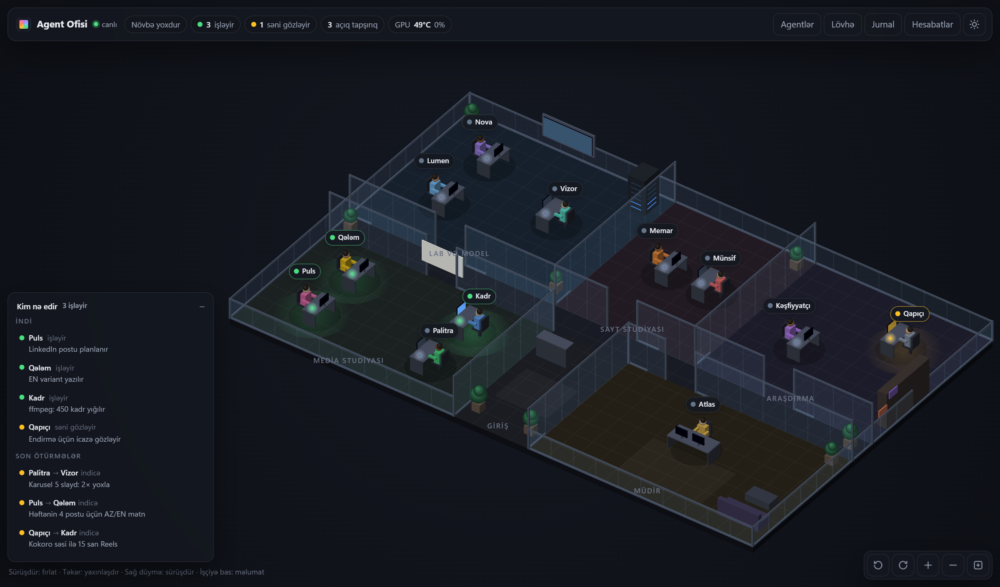

# Agent Ofisi

**Claude Code agentləri üçün canlı 3D ofis.** 11 işçi, bir müdir, ortaq tapşırıq lövhəsi və kimin nə etdiyini gördüyün otaq.



[English](README.md)

## Nə edir

- **Agent komandası.** Mətn, dizayn, video, araşdırma, sayt kodu, yoxlama və lisenziya. Hər işçi nəticəsini özü növbəti işçiyə ötürür.
- **Canlı 3D ofis.** Kimin işlədiyini, gözlədiyini, boş olduğunu, işlərin masadan masaya keçməsini görürsən.
- **Tapşırıq lövhəsi.** İşçiyə bas və tapşırıq yaz, ya da çatda: `Kadr, 15 saniyəlik Reels düzəlt`.
- **Səhər və gecə növbəsi.** `səhər növbəsini başla` de. Müdir hər 15 dəqiqədə işləri paylayır, sonda hesabat yazır.
- **Təhlükəsiz.** Sənin "bəli"n olmadan pullu addım, endirmə, paylaşma, deploy yoxdur.

## Quraşdırma

[Claude Code](https://claude.com/claude-code) və Node 18+ lazımdır. Başqa heç nə: `npm install` yox, API açarı yox.

```sh
git clone https://github.com/Fexreddin-dev/agent-ofisi
cd agent-ofisi
node install.js
```

1. Ofisi aç: `Ofis.bat` (Windows) və ya `./ofis.sh` (macOS/Linux) → http://127.0.0.1:8770
2. Claude Code-u bu qovluqda aç. Bu çat **Atlas**-dır, müdir.
3. Yaz: `Qapıçı, Kokoro TTS-in lisenziyasını yoxla`

## Komanda

| | | | |
|---|---|---|---|
| **Atlas**, müdir | **Qələm**, mətn | **Palitra**, dizayn | **Kadr**, video |
| **Puls**, SMM planı | **Kəşfiyyatçı**, araşdırma | **Qapıçı**, lisenziya, büdcə | **Vizor**, keyfiyyət |
| **Memar**, sayt kodu | **Münsif**, sayt qiyməti | **Nova**, ML modellər | **Lumen**, model Lab-ı |

## Bilməli olduqların

- Memar və Münsif `~/.claude/skills/`-də sayt qurma və sayt qiymətləndirmə skill-i olanda daha yaxşı işləyir (repoya daxil deyil, öz skill-ini qur).
- Hər şey sənin kompüterində qalır: ofis yalnız 127.0.0.1-də açılır, `data/` və `out/` heç yerə getmir.
- Silmək: `node install.js --uninstall` (faylların qalır).

MIT lisenziyası
