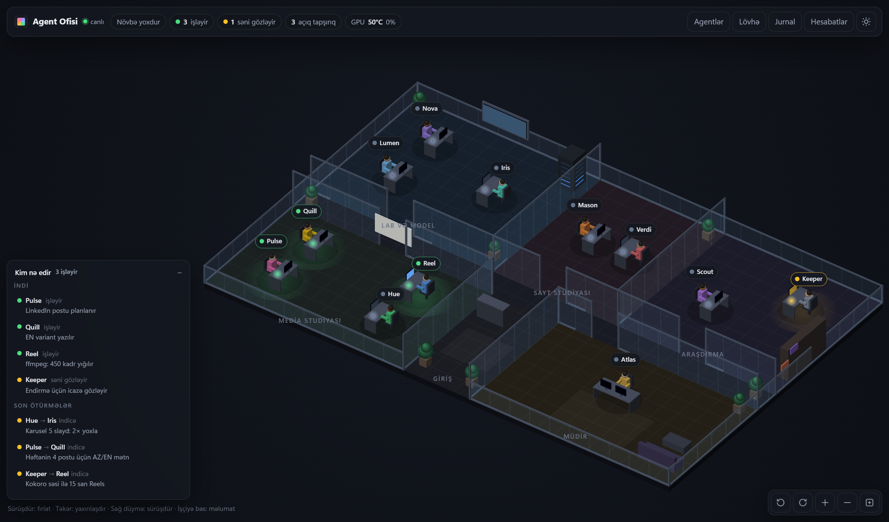

# Agent Ofisi

**A live 3D office for your Claude Code agents.** 11 workers, one manager, a shared task board, and a room where you can watch who is doing what.

[Azərbaycanca](README.az.md)

## What it does

- **Team of agents.** Text, design, video, research, code, review and license checks. Each worker hands its result to the next one automatically.
- **Live 3D office.** See who is working, waiting or idle, and watch tasks move between desks.
- **Task board.** Click a worker and give it a task, or just write in chat: `Reel, make a 15-second Reels`.
- **Day and night shifts.** Say `start the morning shift`. The manager hands out tasks every 15 minutes and writes a report when the shift ends.
- **Safe by default.** No paid steps, no downloads, nothing posted for you and no deploys without your "yes".

## Install

**Before you start:** install [Node.js](https://nodejs.org) (the LTS button) and [Claude Code](https://claude.com/claude-code). Nothing else: no `npm install`, no API keys.

1. **Download.** On this page click the green **Code** button → **Download ZIP**.
2. **Unzip** it to a folder you will keep, for example `Documents\agent-ofisi`. Don't move the folder later, because Claude Code remembers this path.
3. **Install.** Open the folder and double-click **`Install.bat`** (Windows). On macOS/Linux, open a terminal in the folder and run `./install.sh`. You should see a list of ✓ lines.
4. **Open the office.** Double-click **`Ofis.bat`** (macOS/Linux: `./ofis.sh`). Your browser opens http://127.0.0.1:8770.
5. **Start working.** Open Claude Code in the same folder (desktop app: choose this folder; terminal: `cd` into it and run `claude`). That chat is **Atlas**, the manager. Write a task, for example `Keeper, check the license of Kokoro TTS`, and watch the office.

Using git instead of the ZIP: `git clone https://github.com/Fexreddin-dev/agent-ofisi`, then step 3.

## The team

| | | | |
|---|---|---|---|
| **Atlas**, manager | **Quill**, copywriter | **Hue**, designer | **Reel**, video |
| **Pulse**, social media plan | **Scout**, research | **Keeper**, license & budget | **Iris**, quality check |
| **Mason**, website code | **Verdi**, website review | **Nova**, ML models | **Lumen**, model review Lab |

## Good to know

- The UI and the agents speak **Azerbaijani**. To switch, change the language line in `QAYDALAR.md` and `agents/*.md`.
- Mason and Verdi get better with a website-building skill and a website-review skill in `~/.claude/skills/`. They are not included here, so use your own.
- Everything stays on your computer. The office only listens on 127.0.0.1, and `data/` and `out/` never leave your machine.
- Uninstall with `node install.js --uninstall`. Your files stay.

MIT License
